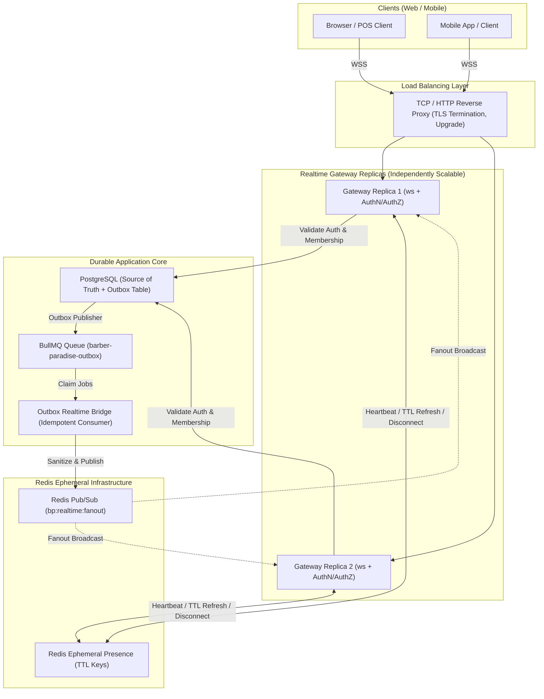
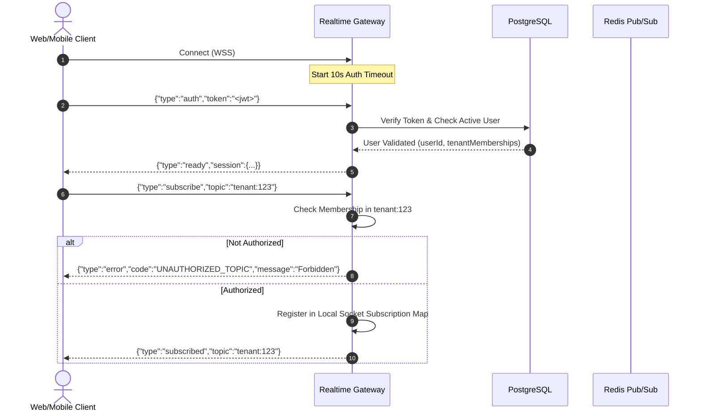
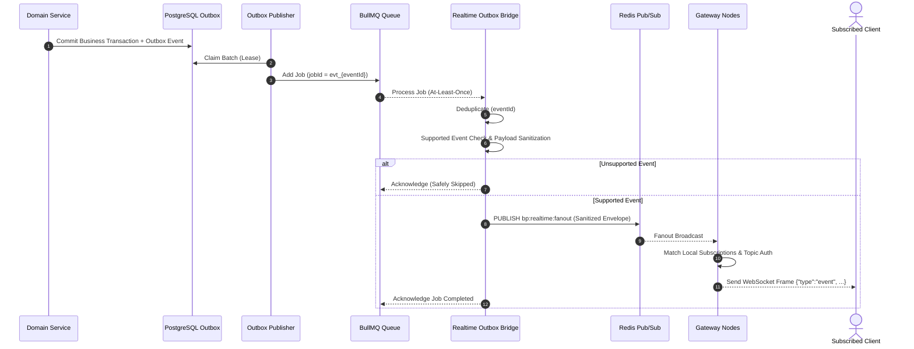

# ADR-047: Realtime Gateway Architecture, Ephemeral Presence & Outbox Fanout Bridge

## Status

**ACCEPTED & IMPLEMENTED — Stage 4.2**

## Context

Barber Paradise v2 requires real-time bidirectional communication for mobile/web clients (instant appointment updates, live barber chair status, order fulfillment notifications, and active user presence) across multiple horizontally scaled gateway instances.

In Stage 4.0 and Stage 4.1, we hardened the transactional PostgreSQL Outbox publisher and established BullMQ queue transport with distributed rate limiting. In Stage 4.2, we must design and deliver an independently scalable Realtime Gateway foundation without introducing microservice decomposition of domain modules or compromising transactional invariants.

### Core Architectural Invariants

1. **PostgreSQL as Sole Authoritative Source of Truth:**
   Realtime is strictly an ephemeral distribution channel. Appointments, financial ledgers, inventory, orders, payments, subscriptions, users, permissions, and tenant memberships are NEVER authored or master-stored in the realtime tier.
2. **Redis as Ephemeral Fanout & Presence Infrastructure:**
   Redis Pub/Sub is utilized solely for transient multi-replica event fanout. Redis keys with TTL are utilized solely for ephemeral presence tracking. Neither Pub/Sub nor Presence is durable storage.
3. **No Long-Lived WebSocket Connections in Serverless Handlers:**
   WebSocket connections cannot be hosted inside Next.js serverless request handlers or API route invocations. The Realtime Gateway runs as an independent, scalable Node.js process.
4. **Durable Origin via PostgreSQL Outbox + BullMQ Bridge:**
   Realtime events originate from authoritative PostgreSQL state changes, recorded into the transactional outbox, published via BullMQ, consumed idempotently by the Realtime Bridge, and broadcast over Redis Pub/Sub.
5. **Fail-Safe Degradation on Realtime / Redis Outage:**
   If Redis Pub/Sub or Realtime Gateways crash or partition, all database transactions and business operations proceed uninterrupted. Clients detect disconnection and fall back to authoritative HTTP REST queries.

---

## Decision

### 1. Transport Evaluation & Selection

We evaluated four candidate transports for client push delivery:

| Transport | Connection Topology | Client Ergonomics | Overhead & Framing | Multi-Replica Scaling | Verdict |
| :--- | :--- | :--- | :--- | :--- | :--- |
| **Server-Sent Events (SSE)** | Unidirectional HTTP stream | Browser native `EventSource` | High connection holding on HTTP server, no client-to-server multiplexing | Needs Redis Pub/Sub per instance | **REJECTED** (Unidirectional; heartbeat/ping and dynamic client subscription requires separate HTTP POSTs) |
| **Socket.IO** | Bi-directional with HTTP polling fallback | Proprietary client library required | Heavy protocol overhead, sticky sessions required for polling handshake | Requires `@socket.io/redis-adapter` with packet buffering | **REJECTED** (Proprietary protocol, unnecessary polling baggage, complex sticky load balancer requirements) |
| **Next.js Route Handlers** | Serverless HTTP function | Standard fetch | Fails on edge/serverless execution limits (timeouts, connection pooling) | Impossible to maintain persistent socket pools | **REJECTED** (Architectural mismatch for long-lived sockets) |
| **Raw Standards-Based `ws` WebSocket** | Full-duplex persistent TCP socket | Native `WebSocket` API across browsers and mobile | Minimal frame overhead, predictable memory footprint, standard ping/pong | Stateless gateway instances fan out via Redis Pub/Sub | **ACCEPTED** (Standard, performant, zero proprietary lock-in, independently scalable) |

### 2. End-to-End System Architecture

---

### 3. Client Authentication & Server-Side Authority

- **Client Authority Rejected:** Any `tenantId`, `userId`, `role`, or `locationId` provided by the client in message frames is untrusted and discarded.
- **Server Verification:** The client transmits a signed session token in an initial `auth` message within 10 seconds of connection establishment. Unauthenticated sockets are closed with code `4401 (Authentication Timeout)`.
- **Authoritative Identity:** The gateway decodes and verifies the cryptographic signature (`HS256` via `AUTH_SECRET`), retrieves or validates active user status against PostgreSQL, and binds the authorized `userId` and platform administration flag to the socket lifecycle.
- **Token Protection:** Raw tokens and credentials are never stored in memory maps, never logged, and never written into Redis presence keys.

---

### 4. Topic Authorization & Tenant Boundary Isolation

Clients subscribe only to strongly-typed, validated topics using the format `{scope}:{id}`:

| Topic Pattern | Target Scope | Authorization Rule |
| :--- | :--- | :--- |
| `tenant:{tenantId}` | Entire tenant broadcast | Authenticated user must have active membership in `tenantId` (or platform admin). |
| `location:{locationId}` | Specific barber shop branch | Location must belong to user's authorized tenant (or platform admin). |
| `professional:{professionalId}`| Assigned barber/staff stream | User must be the professional OR have manager/owner role in that tenant. |
| `appointment:{appointmentId}` | Specific booking updates | User must be the appointment customer, assigned barber, or tenant staff. |
| `order:{orderId}` | POS / Online order updates | User must be the ordering customer or tenant cashier/staff. |
| `customer:{customerId}` | Customer personal updates | User must be the matching customer or tenant staff. |
| `user:{userId}` | Private user notification | Authenticated `userId` must strictly match topic ID (or platform admin). |

Arbitrary topic strings and malformed identifiers are immediately rejected with error responses.

---

### 5. Ephemeral Presence Mechanics

Presence tracks online status and active user sessions across tenant workspaces:

- **Redis Key Structure:** `bp:presence:{tenantId}:{userId}` storing a hash containing connection identifiers, `locationId`, and timestamp.
- **Heartbeat & TTL:** Every connection heartbeat (`ping` -> `pong`) refreshes the presence key with a bounded TTL (60 seconds).
- **Disconnect Cleanup:** Upon socket close or termination, the gateway immediately removes the connection entry from Redis.
- **Bounded Footprint:** Keys naturally expire if a node dies abruptly without graceful cleanup, preventing stale orphaned presence records.

---

### 6. Outbox-to-Realtime Bridge & Payload Sanitization

The bridge bridges the durable PostgreSQL outbox to the ephemeral realtime fanout tier:

#### Sanitization Rules:
1. Internal database column hashes, payment provider tokens, and internal operational logs are stripped before fanout.
2. Only customer- and staff-safe fields (status, IDs, timestamps, total amounts) are dispatched to browser subscribers.

---

### 7. Socket Backpressure & Abuse Defenses

1. **Max Frame Size:** Incoming frames exceeding 32 KB are rejected with WebSocket close code `1009 (Message Too Big)`.
2. **Subscription Limits:** A maximum of 50 subscriptions per socket is enforced. Exceeding attempts trigger an error frame.
3. **Outbound Buffer Backpressure:** If `socket.bufferedAmount` exceeds 1 MB, the socket is classified as a slow consumer and gracefully terminated with code `1008 (Policy Violation)`.
4. **Heartbeat Liveness:** Gateways ping connected sockets every 15 seconds. If no pong or client activity occurs within 30 seconds, the socket is dropped and presence cleaned.
5. **Origin Verification:** In production, WebSocket upgrade requests validate the `Origin` header against `REALTIME_ALLOWED_ORIGINS`.

---

## Consequences

### Positive
- **Independent Scalability:** Gateway replicas can be scaled dynamically without impacting Next.js compute.
- **Zero Financial / Transactional Risk:** Realtime failure does not block bookings, POS checkout, payments, or ledger entries.
- **Strict Tenant Isolation:** Cross-tenant leakage is prevented by server-side topic authorization before socket dispatch.
- **Robust Presence:** Redis TTL guarantees self-healing presence even across catastrophic process terminates.

### Negative / Trade-offs
- Ephemeral delivery over WebSocket is best-effort; clients must re-synchronize state via HTTP REST upon reconnecting.
- Redis Pub/Sub does not buffer offline messages (by design); durable queue semantics are kept strictly within BullMQ.
