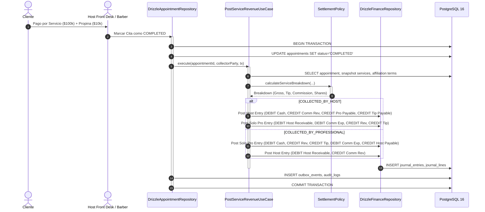
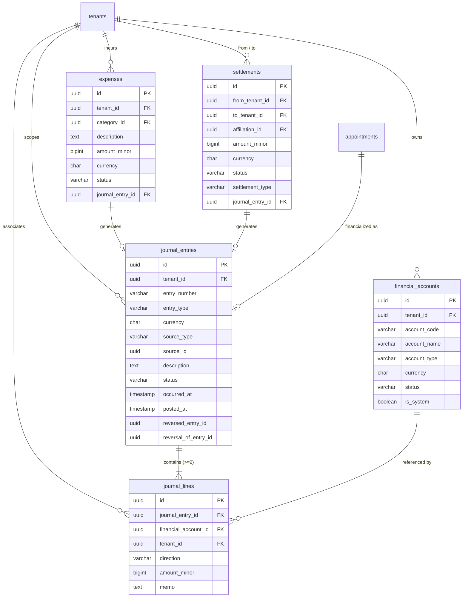

# Financial Core Architecture — Barber Paradise v2 (Stage 3A)

## 1. Architectural Mission & Philosophy
The Financial Core answers mathematically, auditably, and reproducibly:
> **"¿De quién es cada peso y por qué?"**

Key foundations:
- **Append-Only Double-Entry General Ledger**: Every movement requires balanced journal entries satisfying $\sum(\text{DEBITS}) = \sum(\text{CREDITS})$.
- **Zero Mutable Balance Columns**: No `balance` column exists in the database. All account balances and financial summaries are derived dynamically from posted journal lines.
- **Pure PostgreSQL Authority**: Strong consistency ensures that appointment completion and financialization succeed or fail together inside a single ACID transaction.

---

## 2. Transaction Flow & Collection Semantics

---

## 3. Financial Entity Relationship Diagram

---

## 4. Standard Chart of Accounts (Plan Único de Cuentas)

| Código | Nombre de Cuenta | Clasificación | Naturaleza Normal |
| :--- | :--- | :--- | :--- |
| `1010_CASH` | Caja General y Bancos | ASSET | **DEBIT** |
| `1020_ACCOUNTS_RECEIVABLE` | Cuentas por Cobrar Clientes | ASSET | **DEBIT** |
| `1030_HOST_COMMISSION_RECEIVABLE` | Comisión por Cobrar a Profesional | ASSET | **DEBIT** |
| `1040_HOST_CHAIR_RENT_RECEIVABLE` | Alquiler de Silla por Cobrar | ASSET | **DEBIT** |
| `2010_ACCOUNTS_PAYABLE` | Cuentas por Pagar Proveedores | LIABILITY | **CREDIT** |
| `2020_PROFESSIONAL_COMMISSION_PAYABLE`| Comisión por Pagar a Profesional | LIABILITY | **CREDIT** |
| `2030_HOST_COMMISSION_PAYABLE` | Comisión por Pagar a Anfitrión | LIABILITY | **CREDIT** |
| `2040_HOST_CHAIR_RENT_PAYABLE` | Alquiler de Silla por Pagar | LIABILITY | **CREDIT** |
| `2050_TIPS_PAYABLE` | Propinas por Pagar | LIABILITY | **CREDIT** |
| `2099_SETTLEMENT_CLEARING` | Cuenta Puente de Liquidaciones | LIABILITY | **CREDIT** |
| `3010_RETAINED_EARNINGS` | Utilidades Retenidas / Capital | EQUITY | **CREDIT** |
| `4010_SERVICE_REVENUE` | Ingresos por Prestación de Servicios | REVENUE | **CREDIT** |
| `4020_COMMISSION_REVENUE` | Ingresos por Comisión de Sede | REVENUE | **CREDIT** |
| `4030_CHAIR_RENT_REVENUE` | Ingresos por Alquiler de Silla | REVENUE | **CREDIT** |
| `4040_TIP_REVENUE` | Ingresos por Propinas | REVENUE | **CREDIT** |
| `5010_COMMISSION_EXPENSE` | Gastos por Comisión de Sede | EXPENSE | **DEBIT** |
| `5020_CHAIR_RENT_EXPENSE` | Gastos por Alquiler de Silla | EXPENSE | **DEBIT** |
| `5030_OPERATING_EXPENSE` | Gastos Operativos Generales | EXPENSE | **DEBIT** |

---

## 5. Summary Balance Derivation Rules
$$
\text{Saldo}(\text{ASSET, EXPENSE}) = \sum \text{DEBITS} - \sum \text{CREDITS}
$$
$$
\text{Saldo}(\text{LIABILITY, EQUITY, REVENUE}) = \sum \text{CREDITS} - \sum \text{DEBITS}
$$
$$
\text{Utilidad Neta} = \text{Ingresos Totales} - \text{Gastos Totales}
$$
