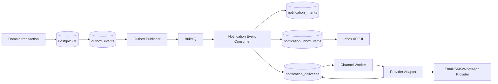
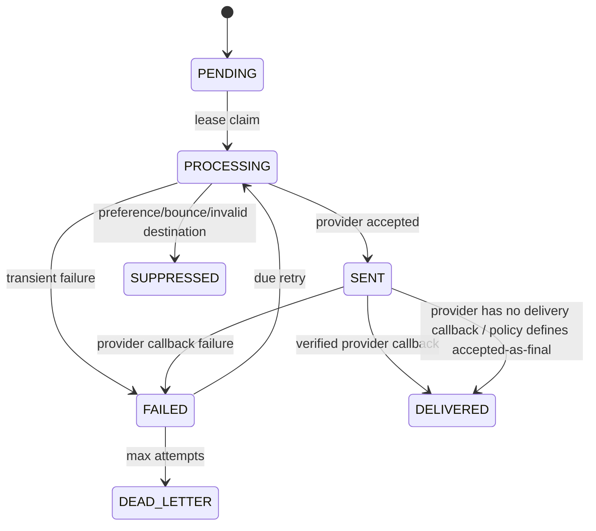

# Stage 4.3 Notifications — Implementation Plan

## Current baseline

Stage 4.0.1, Stage 4.1, and Stage 4.2 are certified and frozen.

Current notification-related infrastructure:

- PostgreSQL transactional outbox;
- BullMQ queue transport over Redis;
- WebSocket realtime gateway;
- Redis Pub/Sub fanout;
- existing event whitelist for realtime;
- an admin Notifications page that is currently UI-only/mock.

There is no certified durable notification domain yet.

## Goal

Build a durable transactional notification platform that can support in-app, email, SMS and WhatsApp delivery while preserving the modular monolith and every previously frozen correctness invariant.

## Actual current event inventory

### Appointment lifecycle

- appointment.created
- appointment.confirmed
- appointment.checked_in
- appointment.in_progress
- appointment.completed
- appointment.cancelled
- appointment.no_show

Status events are generated dynamically from AppointmentStatus.

### Commerce / payments

- order.completed
- order.returned
- payment.intent.created.v1
- payment.succeeded.v1
- payment.failed.v1
- payment.canceled.v1
- payment.expired.v1
- payment.refund.succeeded.v1

### Professionals

- professional.created.v1
- professional.affiliation.requested.v1
- professional.affiliation.activated.v1
- professional.affiliation.suspended.v1
- professional.affiliation.ended.v1

### SaaS subscriptions

- subscription.invoice.generated.v1
- subscription.invoice.paid.v1
- subscription.plan_change_scheduled.v1
- subscription.plan_changed.v1
- subscription.cancel_scheduled.v1
- subscription.cancelled.v1
- subscription.reactivated.v1
- subscription.resumed.v1
- subscription.suspended.v1
- subscription.trial_expired.v1
- subscription.trial_extended.v1

Provider webhook event_type values and audit/system events are not automatically notification events.

## Delivery architecture

## Failure / retry flow

## Stage 4.3B — Durable core

### Scope

1. Add notification schema and migration.
2. Introduce notification module:
   - domain types;
   - policy registry;
   - recipient resolution;
   - preference evaluation;
   - intent repository;
   - delivery repository;
   - inbox repository.
3. Implement idempotent outbox-event consumer that creates durable notification records.
4. IN_APP channel must work end-to-end without an external provider.
5. No production email/SMS/WhatsApp provider in 4.3B.

### Database invariants

- unique notification dedupe key;
- unique notificationIntentId + channel;
- unique notificationIntentId + inbox user;
- tenant-scoped indexes;
- due-delivery indexes;
- lease indexes;
- no cascade capable of deleting historical provider delivery evidence accidentally.

### Tests

At minimum:

- same event delivered 50 times creates one logical intent per recipient/policy;
- multiple workers do not claim same delivery;
- stale worker cannot settle new lease;
- preference opt-out suppresses optional channel;
- mandatory policy survives optional opt-out;
- cross-tenant recipient resolution is rejected;
- historical outbox/realtime behavior remains unchanged;
- IN_APP inbox creation/read state is durable.

### Exit criteria

- dedicated tests green twice;
- all frozen tests green;
- typecheck/lint/build pass;
- fresh DB migration pass;
- commit and clean working tree.

## Stage 4.3C — Channel workers

### Scope

1. Provider-neutral channel interfaces.
2. Fake deterministic providers for tests.
3. EMAIL/SMS/WHATSAPP infrastructure adapters enabled only by explicit configuration.
4. Destination resolution at send time.
5. Masking/hashing for logs and durable operational correlation.
6. Hard provider timeouts.
7. Exponential retry with jitter.
8. Quiet-hours scheduler using IANA timezone.
9. Suppression registry.
10. Provider callback foundation.

### Safety

- no message body or raw contact information in structured logs;
- provider credentials only from validated environment configuration;
- no fallback provider unless explicitly configured;
- mandatory notification does not imply every channel is mandatory;
- SMS/WhatsApp budget/rate controls are required before production enablement.

### Tests

- provider timeout does not hang worker;
- non-cooperative provider timeout is bounded;
- late provider rejection does not create unhandled rejection;
- duplicate worker execution does not duplicate durable delivery;
- quiet-hour deferral around DST/timezone boundaries;
- invalid destination suppression;
- hard bounce/complaint suppression;
- sanitized logs;
- out-of-order callback handling.

## Stage 4.3D — APIs, UI and certification

### APIs

Proposed authenticated endpoints:

- GET /api/v1/notifications
- POST /api/v1/notifications/{id}/read
- POST /api/v1/notifications/{id}/archive
- GET /api/v1/notification-preferences
- PUT /api/v1/notification-preferences

Operational/admin APIs require explicit authorization and must never expose secrets or full provider payloads.

### UI

Replace the existing mock admin Notifications page with real operational data.

Separate:

- personal inbox/preferences;
- tenant notification configuration;
- operational delivery health;
- future marketing campaigns.

Do not mix transactional notification controls with marketing consent.

### Certification

Required:

- fresh disposable PostgreSQL migration;
- 50-way duplicate event race;
- 50-way delivery claim race;
- cross-tenant security suite;
- quiet-hours tests;
- suppression tests;
- provider timeout/failure tests;
- existing Stage 4.0/4.1/4.2 regression suites;
- payment webhook concurrency suite unchanged;
- npm run typecheck;
- npm run lint;
- npm test;
- npm run build.

## Explicit non-goals until Stage 4.3 is frozen

- marketing campaign builder;
- newsletter/bulk-send engine;
- customer segmentation;
- AI-generated campaigns;
- media/CDN pipeline;
- microservices extraction;
- Kubernetes.

## Next stage after freeze

Stage 5 should remain the Media/Object Storage/CDN stage. Notifications must not expand sideways into media infrastructure.
