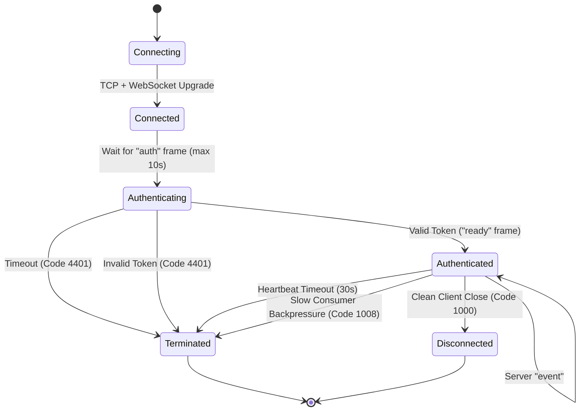

# Realtime Gateway Protocol Specification (v1)

## Overview

The Barber Paradise Realtime Gateway communicates with browser and mobile clients using standard JSON-encoded WebSocket text frames over secure WebSockets (`wss://`).

- **Protocol Version:** `1.0`
- **Encoding:** UTF-8 JSON text frames
- **Maximum Frame Size:** 32,768 bytes (32 KB)
- **Default Port:** `9003`

---

## 1. Connection Lifecycle



---

## 2. Client Messages (Inbound)

Every client message must be valid JSON containing a `type` string matching one of the supported types:

### 2.1 `auth`
Authenticates the socket session using a valid session JWT token. Must be the first message sent on a newly established connection.

```json
{
  "type": "auth",
  "token": "eyJhbGciOiJIUzI1NiIsInR5cCI6IkpXVCJ9..."
}
```

- **Validation:**
  - `token`: Non-empty string.
- **Rules:**
  - Client-supplied claims in other messages are ignored. The server verifies this token against `AUTH_SECRET` and authoritative DB records.
  - If sent multiple times on an already authenticated socket, the server updates identity (re-authentication).

### 2.2 `subscribe`
Requests subscription to a specific authorized topic.

```json
{
  "type": "subscribe",
  "topic": "tenant:01918349-f831-7b00-a548-bc38029c118e"
}
```

- **Validation:**
  - `topic`: Valid topic pattern matching `^[a-zA-Z0-9_-]+:[a-zA-Z0-9_-]+$`.
- **Rules:**
  - Socket must be authenticated.
  - Server verifies caller has permission to view this topic.
  - Maximum 50 active subscriptions per socket.

### 2.3 `unsubscribe`
Removes subscription to a topic.

```json
{
  "type": "unsubscribe",
  "topic": "tenant:01918349-f831-7b00-a548-bc38029c118e"
}
```

### 2.4 `ping`
Client-initiated heartbeat probe to verify liveness and refresh presence TTL.

```json
{
  "type": "ping",
  "timestamp": 1760000000000
}
```

---

## 3. Server Messages (Outbound)

### 3.1 `ready`
Sent when authentication succeeds.

```json
{
  "type": "ready",
  "session": {
    "userId": "usr_01918349-f831-7b00-a548-bc38029c118e",
    "email": "barber@paradise.com",
    "name": "Jane Barber",
    "isPlatformAdmin": false
  }
}
```

### 3.2 `subscribed`
Confirms subscription to a requested topic.

```json
{
  "type": "subscribed",
  "topic": "tenant:01918349-f831-7b00-a548-bc38029c118e"
}
```

### 3.3 `unsubscribed`
Confirms removal of subscription.

```json
{
  "type": "unsubscribed",
  "topic": "tenant:01918349-f831-7b00-a548-bc38029c118e"
}
```

### 3.4 `event`
Dispatches a business domain event to subscribers of an authorized topic.

```json
{
  "type": "event",
  "topic": "tenant:01918349-f831-7b00-a548-bc38029c118e",
  "eventId": "evt_01918349-f831-7b00-a548-bc38029c118f",
  "eventType": "appointment.created",
  "occurredAt": "2026-10-08T18:00:00.000Z",
  "payload": {
    "appointmentId": "apt_01918349-f831-7b00-a548-bc38029c1190",
    "status": "CONFIRMED",
    "scheduledAt": "2026-10-08T19:00:00.000Z",
    "professionalId": "pro_01918349-f831-7b00-a548-bc38029c1191"
  }
}
```

### 3.5 `error`
Sent when an operation fails or a protocol violation occurs.

```json
{
  "type": "error",
  "code": "UNAUTHORIZED_TOPIC",
  "message": "Access to requested topic is denied",
  "retryable": false
}
```

### 3.6 `pong`
Server response to client `ping`.

```json
{
  "type": "pong",
  "timestamp": 1760000000000
}
```

---

## 4. Error Codes & WebSocket Close Codes

### Application Error Codes (JSON Frame)
- `MALFORMED_MESSAGE`: Inbound frame could not be parsed as valid JSON or violates schema.
- `UNKNOWN_MESSAGE_TYPE`: The `type` field is unrecognized.
- `AUTH_REQUIRED`: The socket attempted an action requiring prior authentication.
- `AUTH_FAILED`: Provided token is invalid, expired, or user is suspended.
- `UNAUTHORIZED_TOPIC`: Subscription denied due to missing tenant membership or lack of permissions.
- `SUBSCRIPTION_LIMIT_EXCEEDED`: Max 50 subscriptions per socket reached.
- `RATE_LIMIT_EXCEEDED`: Connection or auth attempts exceeded the token bucket rate limit.

### WebSocket Close Codes
- `1000 Normal Closure`: Socket closed cleanly by client or server drain.
- `1008 Policy Violation`: Frame exceeded max size, rate limit abuse, or slow consumer backpressure.
- `1009 Message Too Big`: Frame exceeded 32 KB threshold.
- `1012 Service Restart`: Graceful gateway shutdown; signals client to reconnect with jitter.
- `4401 Authentication Required`: Handshake timed out after 10s without valid credentials.
