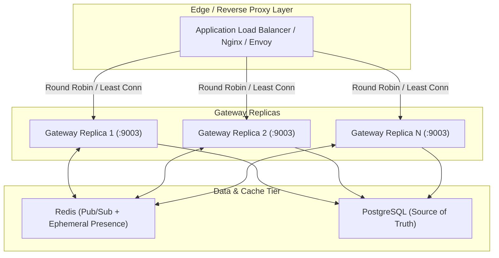

# Realtime Gateway Operational Runbook & Load Balancing Architecture

## 1. Gateway Overview & Topology

The Realtime Gateway runs as a cluster of stateless Node.js processes running alongside the primary Next.js HTTP application.



### Key Operational Characteristics:
- **Stateless Replicas:** Any client can connect to any gateway replica. No sticky sessions are required.
- **Failover:** If a replica crashes, the client reconnects to any surviving replica and re-authenticates/re-subscribes.
- **Presence Self-Healing:** Ephemeral presence keys have a 60-second TTL in Redis. If a gateway terminates abnormally, presence records expire naturally without leaving orphaned entries.

---

## 2. Load Balancer Configuration (Nginx / ALB)

### Reverse Proxy Settings:
- **Upgrade Support:** Ensure `Upgrade` and `Connection` headers are passed:
  ```nginx
  proxy_set_header Upgrade $http_upgrade;
  proxy_set_header Connection "upgrade";
  ```
- **Timeouts:**
  - `proxy_read_timeout 60s;` (Clients ping every 15s, so 60s timeout provides a 4x margin).
  - `proxy_send_timeout 60s;`
- **Origin Validation:** Gateways validate `Origin` header against `REALTIME_ALLOWED_ORIGINS`.

---

## 3. Health & Readiness Probes

The Realtime Gateway exposes HTTP probe endpoints on the same port:

| Endpoint | Method | Purpose | Response Format |
| :--- | :--- | :--- | :--- |
| `/health` | `GET` | Process liveness probe | `200 OK: {"status":"healthy","uptime":123}` |
| `/ready` | `GET` | Traffic readiness probe (verifies Redis & DB) | `200 OK: {"status":"ready","redis":"healthy"}` |

---

## 4. Reconnect Storm Mitigation

When an entire gateway cluster or network layer restarts, thousands of clients may attempt to reconnect simultaneously:

1. **Client Reconnect Jitter:**
   Clients must implement truncated exponential backoff with full jitter:
   $$t_{reconnect} = \min(t_{max}, t_{base} \times 2^{attempt}) \times (0.5 + 0.5 \times \text{random}())$$
2. **Distributed Token-Bucket Rate Limiting:**
   Connection and authentication requests are rate-limited via Redis atomic token buckets (`realtime.connect` policy) to prevent overloading PostgreSQL.
3. **Graceful Draining:**
   During deployments, gateways send close code `1012 (Service Restart)` to connected clients and stop accepting new connections, spreading re-connections over the drain window.

---

## 5. Metrics & Observability

Key telemetry tracked:
- `realtime_connections_active`: Gauge of active WebSocket connections per node.
- `realtime_auth_success_total` & `realtime_auth_failure_total`: Counter for authentication outcomes.
- `realtime_subscriptions_total` & `realtime_unauthorized_topics_total`: Topic subscription metrics.
- `realtime_messages_received_total` & `realtime_messages_sent_total`: Inbound/outbound frame throughput.
- `realtime_slow_consumer_disconnects_total`: Count of sockets terminated due to `bufferedAmount` exceeding 1 MB threshold.
- `realtime_fanout_latency_ms`: Time from BullMQ job creation to Redis fanout dispatch.

---

## 6. Disaster Recovery & Degraded Modes

| Failure Scenario | Impact | Recovery Action |
| :--- | :--- | :--- |
| **Redis Down / Unreachable** | Realtime fanout and presence degrade. WebSockets stay open or reject new subscriptions gracefully. | Business transactions in PostgreSQL continue uninterrupted. Gateway automatically attempts reconnecting. Clients fall back to HTTP REST polls. |
| **Outbox Bridge Lag** | Events are queued durably in BullMQ; clients experience delayed realtime push. | Scale worker concurrency; verify Redis memory and PostgreSQL lease queries. |
| **Gateway Node Crash** | Sockets connected to that node disconnect. | Load balancer shifts traffic to healthy nodes. Clients reconnect and re-authenticate within jitter window. Redis presence TTL clears old node records. |
